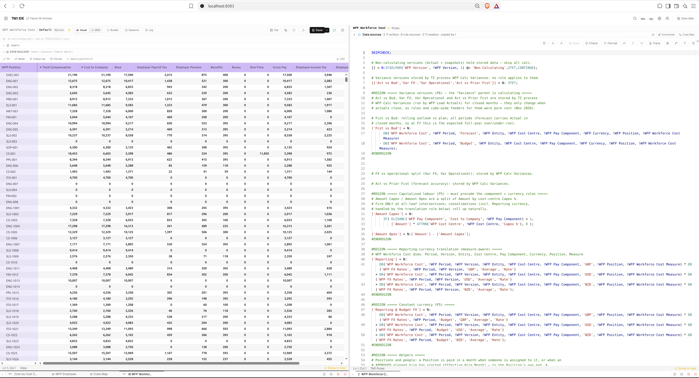
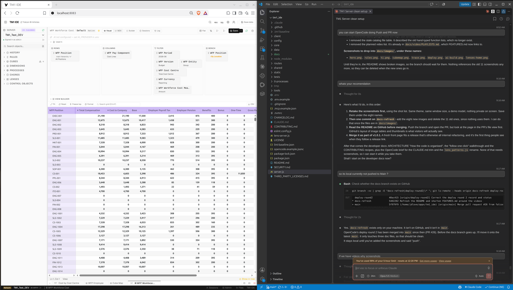
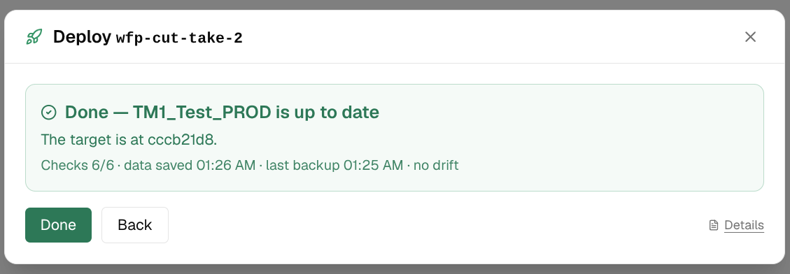

<div align="center">

# TM1 IDE

**An open development experiment for the IBM Planning Analytics (TM1) community.**

[](https://github.com/falconbi/tm1_ide/actions/workflows/ci.yml)
[](https://nodejs.org)
[](LICENSE)

</div>

A browser-based TM1 development environment that explores what modern TM1 development could
look like. It covers AI agents working through MCP, governed changes and deployment, and web
applications built on TM1 data.

It's working software, actively developed and shared openly as a codebase to learn from and
build on. **This is a community project, not a supported product.**

[](https://www.youtube.com/watch?v=_-BWl_n-aWU)

> [!NOTE]
> **Security:** the IDE is designed for local, single-user development, not as a shared
> multi-user web service. Protect your credentials, test on non-production servers first, and
> read the [security model](SECURITY.md) before connecting to an important TM1 system.

---

## ▶ Watch it working

Short videos, a few minutes each, recorded on a live TM1 server.

| | Video | What you'll see |
|---|---|---|
| ▶ | **[IDE Basics](https://www.youtube.com/watch?v=_-BWl_n-aWU)** | Connecting, the Explorer, tabs and split panes, and the editors at a glance |
| ▶ | **[Rules Editor](https://www.youtube.com/watch?v=q-eoEeDHwSA)** | Writing rules and feeders, checking them, and tracing a calculation |
| ▶ | **[TI Editor](https://www.youtube.com/watch?v=vmZzt2ud_og)** | Writing, running and debugging TI processes |
| ▶ | **[Dimension Editor](https://www.youtube.com/watch?v=qGAjW8m_vAg)** | Dimensions, hierarchies, attributes, picklists and subsets |
| ▶ | **[IDE Views](https://www.youtube.com/watch?v=wD6n-vdmCLI)** | Native and MDX views, subsets, hierarchies, working the grid and tracing a number |
| ▶ | **[Cube Map](https://www.youtube.com/watch?v=MM62ZqC3pjk)** | A whole model on one page: the map, the Runbook and Play a run |

**Coming soon** — in production now:

| | Video | What you'll see |
|---|---|---|
| Soon | **MCP Server — build with AI** | An agent builds dimensions, cubes, rules and processes through the MCP server |
| Soon | **Lenses — a new UI** | Purpose-built screens on live TM1 data, built in the IDE and opened by business users |
| Soon | **Deploy with Git** | A change set through release, approval and deploy with TM1 Git |
| Soon | **Administration and installation** | Install the IDE and Lens app, connect a server, and run it day to day |

---

## Why this project exists

AI agents, MCP and modern web tools are changing how software is built. TM1 can benefit from
that too. This project explores how, through working code rather than slides. It brings together
a development environment, an MCP server for AI-assisted model building, and a way to build
focused web applications on TM1.

## What this project explores

### A modern TM1 development environment
Rules and TI with live checking, a debugger, dimensions, views, subsets and MDX, all in one browser
tab. The Cube Map draws the whole model, and any number can be traced back to its rule.

See [the videos](#-watch-it-working) and [all features](docs/ide/FEATURES.md).

### MCP and AI-assisted model building
An MCP server gives AI agents structured tools to inspect, build and test TM1 models. The
questions it explores:
- Can an agent build a real model?
- How are standards communicated and enforced?
- How is the result tested?
- How do people stay in control?

A financial consolidation engine was built this way, test-first:
[how it was built](https://falconbi.github.io/articles/consolidation-built-by-ai/) ·
[MCP server guide](docs/ide/MCP_SERVER.md).

[](docs/ide/MCP_SERVER.md)

### Governed development
As more of the building is automated, governance matters more, not less. Every save goes into a
change set. Tests live in the model. A release ships exactly one change set through TM1's built-in
Git, with review, approval, deploy and verify steps.
See the [deployment guides](#deployment), or [why the deploy works this way](https://falconbi.github.io/articles/governed-tm1-deploys/).

<a href="https://falconbi.github.io/articles/how-tm1-deploys-work/"></a>

### Deployment
How a change moves from DEV to PROD without carrying anyone else's work, and without wiping what
PROD changed by itself:
**[How a TM1 deploy works](https://falconbi.github.io/articles/how-tm1-deploys-work/)** (the whole
process, step by step, with diagrams) ·
[Deploying Lenses](https://falconbi.github.io/articles/deploying-lenses/).

> [!NOTE]
> **Status (27 November 2026).** Proven end to end on a lab pair: DEV to PROD, and DEV to TEST to
> PROD (TM1 v11).
>
> A deploy is two phases. **Pre-deploy** reads the target and changes nothing on it: Check PROD
> (busy, changed since its last deploy, what it has that DEV does not), Tests & close, Build
> release, Review. The release starts from **the target's own copy** for dimensions, hierarchies,
> subsets, views and chores, and applies exactly one change set on top; rules, processes and cube
> structure come from DEV. So what PROD did by itself is never rolled back, and no refresh step is
> needed to protect it. **Deploy** is one screen: approve, Save Data, backup, TM1 Git pull, then
> what Git cannot carry, then verify and record. One change set per deploy, one deploy per target
> at a time, and a sign-off once someone has tested it.
>
> Sync DEV is separate and optional, for when you want PROD's own changes on DEV. TEST is a
> rehearsal: re-clone it from PROD between cycles.
>
> [How a TM1 deploy works](https://falconbi.github.io/articles/how-tm1-deploys-work/) is the process
> with diagrams; [DEPLOY_LIFECYCLE.md](docs/deploy/DEPLOY_LIFECYCLE.md) is the operating detail and
> the open items.
>
> [Governed TM1 deploys](https://falconbi.github.io/articles/governed-tm1-deploys/) explains why a
> release ships one change set.

### Web applications on TM1 (Lenses)
Focused HTML screens on live TM1 data, one per job, with governed write-back. They're built in the
IDE, live in the TM1 model, and open in the separate Lens app — people sign in as themselves, and
TM1 security decides what each person sees and changes. Lenses can be drafted, shared with chosen
reviewers and published, with version history and rollback. Moving them to PROD is its own governed
deploy: compare, approve and deploy published Lenses, with per-Lens verification and history.

[How Lens deploy works](https://falconbi.github.io/articles/deploying-lenses/).


## Three applications, one codebase

| Application | Entry point | What it's for |
|---|---|---|
| **IDE** | `server.js` | Developing and governing TM1 models |
| **Lens app** | `lens-server.js` | Running Lenses for business users |
| **MCP server** | `tools/tm1mcp/server.js` | AI agents working with TM1 models |

All three share one `core/`: the TM1 client, the connection adapters (direct or through PAW,
v11 and v12) and change logging. The function catalog is shared from `shared/`. See
[Architecture](docs/ide/ARCHITECTURE.md).

## Status and expectations

It's real code, used to build real models, and it's still evolving. Please know before you use it:

- **Actively developed.** Features, interfaces and internals change, sometimes in breaking ways.
- **Still being tested.** Not every feature has been tested on every TM1 version and setup. Expect
  bugs.
- **No support or guarantees.** It's provided as-is under the MIT licence. There's no promised
  response to issues or requests.
- **Your environment, your responsibility.** Understand what an operation does and validate changes
  before applying them to an important server.

See the [bug-fix log](docs/ide/BUG_FIXES.md) and [changelog](CHANGELOG.md) for what changes and how
often.

It isn't an IBM product and isn't supported by IBM.

## Getting started

Installing for yourself, or asking an AI agent to install it for someone? Follow
[INSTALL.md](INSTALL.md) step by step. It asks for the values it needs up front, then covers the
install, a success check and the common first-run errors.

```bash
git clone https://github.com/falconbi/tm1_ide.git
cd tm1_ide
npm ci
# copy config/servers.example.json to config/servers.json, then edit it (Windows: copy config\servers.example.json config\servers.json)
npm start                   # → http://localhost:8083
```

You need Node.js 22 (20 also works) and Git. The frontend is pre-built, so no client install or
build is needed to run it. `config/servers.json` isn't in the repo (it holds a password); `.env` is
optional for a direct connection. Tested on Linux, and on Windows 10 with TM1 v11 for install,
start, sign-in and opening a cube — see the [Windows notes](docs/ide/SETUP.md#windows-partly-tested).
Then see the [first walkthrough](docs/ide/WALKTHROUGH.md).

## Take it apart

You don't need to adopt the whole application to get something from it.

| If you're… | You might take |
|---|---|
| A TM1 developer | The editors, the checks, the Cube Map, the development ideas |
| Building AI agents | The MCP server and its TM1 tools |
| Designing deployment | The change sets, the tests in the model, the Git release flow |
| A web developer | The Lens approach to apps on TM1 data |

Clone it, fork it, change it, or build something better. Bug reports with steps to reproduce,
ideas and pull requests are welcome, but there's no promise they'll be accepted or maintained. See
[Contributing](CONTRIBUTING.md).

## Documentation

[Install](INSTALL.md) · [Setup](docs/ide/SETUP.md) · [Features](docs/ide/FEATURES.md) ·
[Architecture](docs/ide/ARCHITECTURE.md) · [MCP server](docs/ide/MCP_SERVER.md) ·
[Deploy lifecycle](docs/deploy/DEPLOY_LIFECYCLE.md) · [Security](SECURITY.md) ·
[Changelog](CHANGELOG.md) · [Bug fixes](docs/ide/BUG_FIXES.md) · [All guides](docs/README.md)

## Licence

MIT. You may use, copy, change and share the code, provided the copyright and licence notice are
kept. See [LICENSE](LICENSE). IBM, Planning Analytics and TM1 are trademarks of IBM.

---

<div align="center">

**Built to explore. Shared to inspire.**

Take it, learn from it, change it, or build something entirely different with it.

</div>
