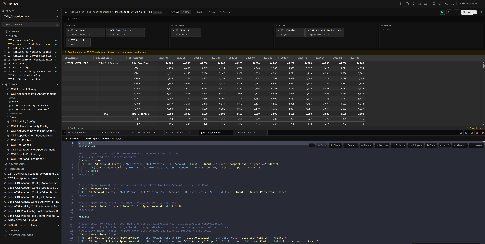
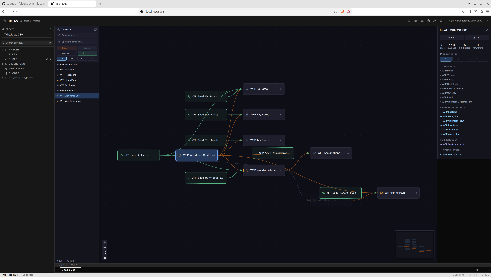
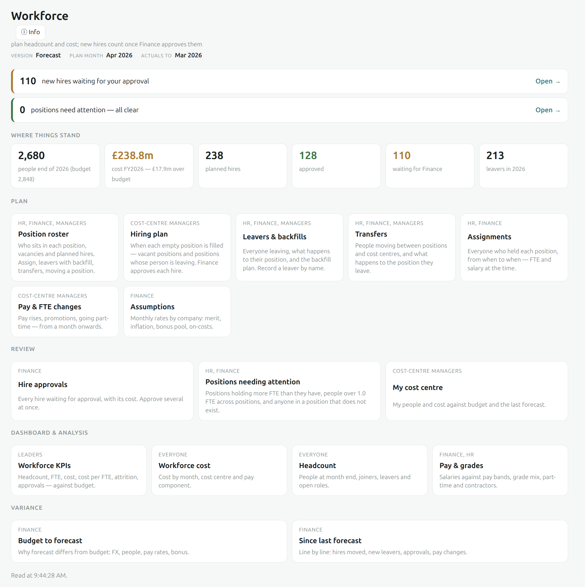

<div align="center">

# TM1 IDE

**A browser-based IDE for IBM Planning Analytics (TM1)**

[](https://github.com/falconbi/tm1_ide/actions/workflows/ci.yml)
[](https://nodejs.org)
[](LICENSE)
[](https://www.ibm.com/products/planning-analytics)
[](https://microsoft.github.io/monaco-editor/)

**The whole TM1 development loop in one browser tab — write, test, trace, map and deploy.**

Nothing to install on the server.

</div>

---

<p align="center">
  
</p>

<p align="center">
  
</p>

---

## Quick start

```bash
git clone https://github.com/falconbi/tm1_ide.git
cd tm1_ide
npm install
cp .env.example .env
npm start                   # → http://localhost:8083
```

Node.js **20 or later**. The frontend is pre-built. Full instructions: [Setup](docs/ide/SETUP.md).

## Videos

Short walkthroughs (30–60s each):

- [IDE Basics](https://www.youtube.com/watch?v=_-BWl_n-aWU)
- [Rules Editor](https://www.youtube.com/watch?v=q-eoEeDHwSA)
- [TI Editor](https://www.youtube.com/watch?v=vmZzt2ud_og)
- [Cube Map](https://www.youtube.com/watch?v=MM62ZqC3pjk)
- [Build Your Own TM1: Start Here](https://www.youtube.com/watch?v=dEsmssko4eY)

Full list on the [docs site](https://falconbi.github.io/tm1_ide/).

## What's in it

- **Monaco editor for rules and TI** — TM1-aware autocomplete, signature help, formatting, folding, regions, and live validation. TI debugger with breakpoints and watches.
- **Cube Map** — visual of every cube and how data moves (rules, feeders, TI). Run sequence, process summary, transaction log. Right-click any cell to trace the rule chain.
- **Assertions** — known-good answers that run after every build and deploy.
- **Governed deploy** — change sets through TM1’s built-in Git: test → close → build release → review → approve → deploy → verify. [How it works](https://falconbi.github.io/articles/governed-tm1-deploys/).
- **MCP server** — AI agents (Claude Code, etc.) can build dimensions, cubes, rules and processes inside change sets, checked by the same tests. [How a consolidation engine was built this way](https://falconbi.github.io/articles/consolidation-built-by-ai/).

Also: dimension, subset, view, chore and cube editors, view grid with writeback, sessions/jobs monitors, server admin, file manager, SQL editor, MDX builder, Period Builder. Connects directly over the REST API or through PAW (v11 and v12). [Full feature list](docs/ide/FEATURES.md).

## Lenses (in development)

Single-file HTML apps that turn a TM1 model into a focused web interface (assumptions, people, positions, hire approvals, cost, KPIs, etc.). Built and previewed inside the IDE.

The Workforce planning model is the worked example. The model and its Lenses live in TM1, not in this repository.

<p align="center">
  
</p>

## Why it exists

AI agents can now build TM1 models, and a modern browser UI can replace the old desktop workflow. This project is a working example of both: a clean development loop, an MCP server for agents, and governed deployment. It is a demonstration and reference — not a supported product.

> [!IMPORTANT]
> **Deployment runs on TM1's built-in Git (preview).** Step-by-step with approvals, drift checks and model-owned history. Lab-tested, not yet production-proven — use on test servers.

> [!WARNING]
> **Pre-release — for initial testing only.**
> Active development. Expect rough edges and breaking changes. Do not use in production without understanding the risks.

## Documentation

Start here: [Setup](docs/ide/SETUP.md) → [Features](docs/ide/FEATURES.md) → [Architecture](docs/ide/ARCHITECTURE.md) → [CLAUDE.md](CLAUDE.md).

| Guide | What's in it |
|---|---|
| [Features](docs/ide/FEATURES.md) | Every editor and tool, with screenshots |
| [Setup](docs/ide/SETUP.md) | Install, configure, run, development mode |
| [First walkthrough](docs/ide/WALKTHROUGH.md) | Connect, edit, build, trace, govern a change |
| [Deploy lifecycle](docs/deploy/DEPLOY_LIFECYCLE.md) | Change-set releases through TM1 Git |
| [Governed TM1 deploys](https://falconbi.github.io/articles/governed-tm1-deploys/) | Article on how and why the deploy works |
| [MCP server](docs/ide/MCP_SERVER.md) | Connecting an AI agent |
| [Architecture](docs/ide/ARCHITECTURE.md) | How the pieces fit |
| [Authentication](docs/auth/AUTHENTICATION.md) | How the IDE signs in |
| [TM1 Authentication Guide](docs/auth/TM1_AUTHENTICATION_GUIDE.md) | Every TM1 sign-in method, plain English |
| [HTML apps on TM1: security](docs/lenses/TM1_HTML_APPS_SECURITY.md) | Browser security when screens are HTML you write |
| [Lens learning lab](docs/learn/lens-lab/README.md) | Five browser-security ideas you can break on purpose |
| [Building models](docs/models/BUILDING_MODELS.md) | Lessons and TM1 quirks from real builds |
| [v1.0 release notes](docs/ide/RELEASE_NOTES_v1.0.md) | What is in v1.0 and known limits |
| [Contributing](CONTRIBUTING.md) | Node version, tests, lint, CI |
| [Changelog](CHANGELOG.md) | Monthly summary of user-visible changes |
| [Bug fixes](docs/ide/BUG_FIXES.md) | Every bug fix, by date |
| [Security](SECURITY.md) | The security model |
| [IBM REST API](docs/ide/Planning%20Analytics.postman_collection.json) | Postman collection |

Keyboard shortcuts: `F1` or `Ctrl+Shift+K` in the app.

## Status

Active development. Core IDE features are usable. The Workforce model and its Lenses stay in TM1 (not in this repo). MCP and the deployment pipeline are still being proven on real builds.

---

<div align="center">
Built for the IBM Planning Analytics community · <a href="https://github.com/falconbi/tm1_ide/issues">Report an issue</a>
</div>
